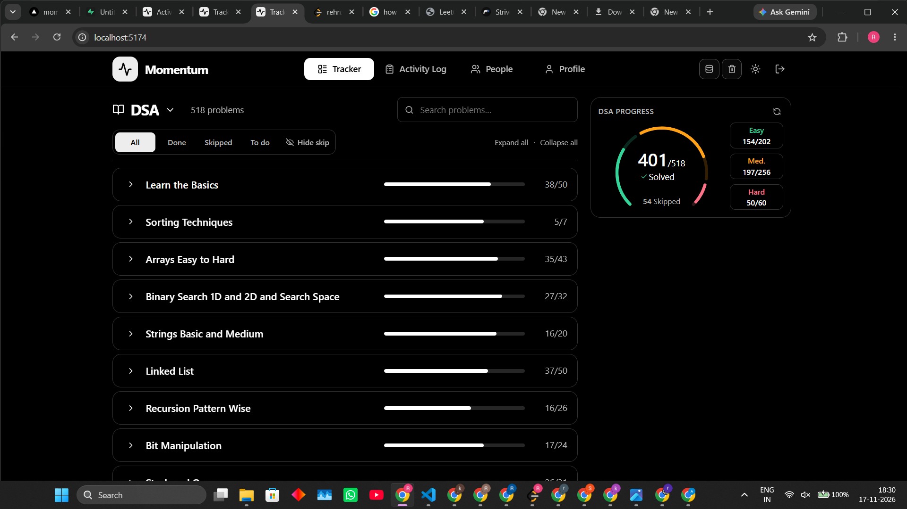
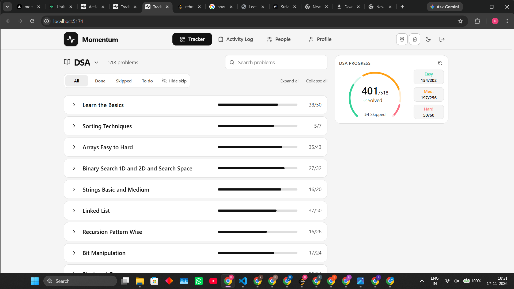
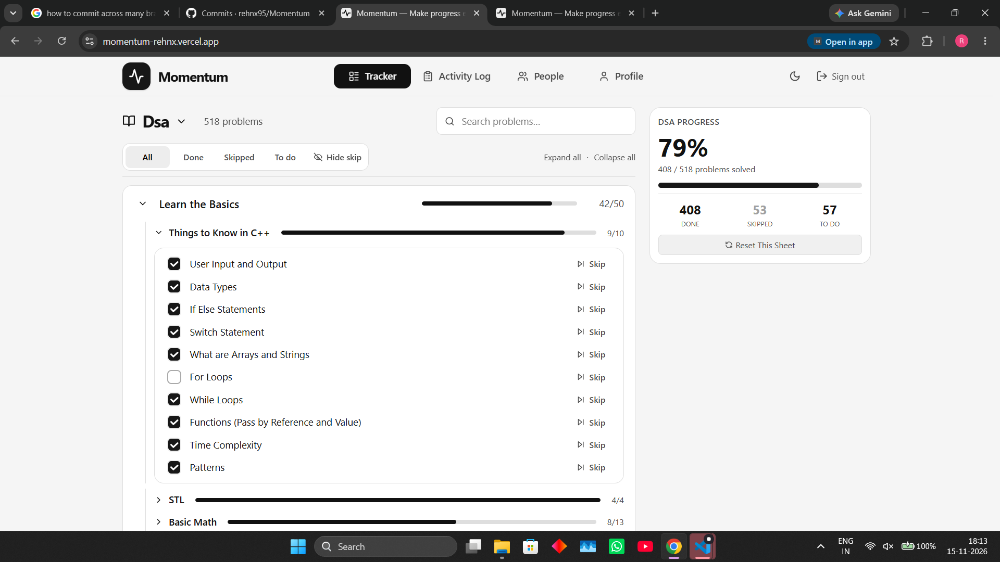
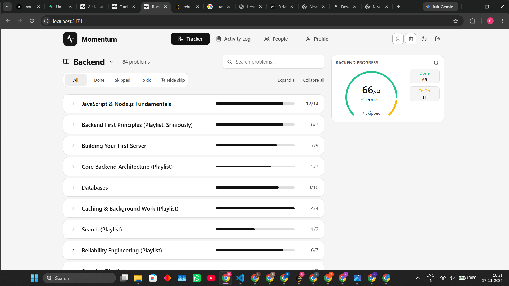
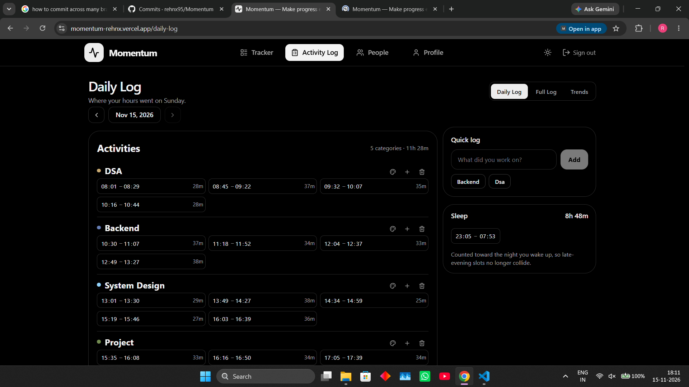
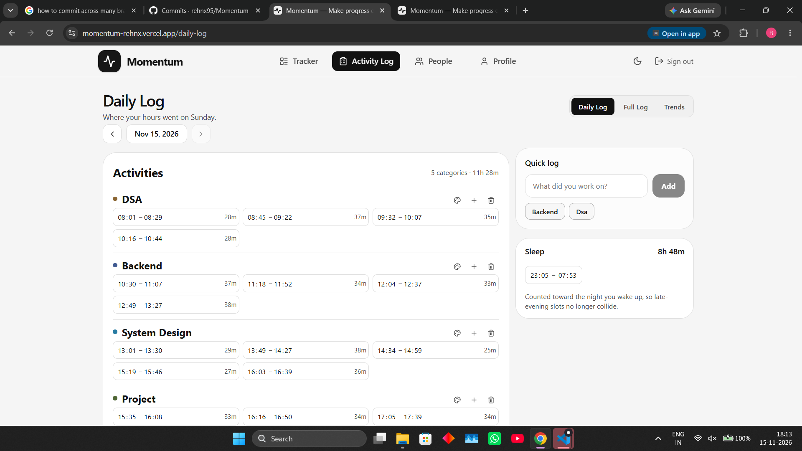
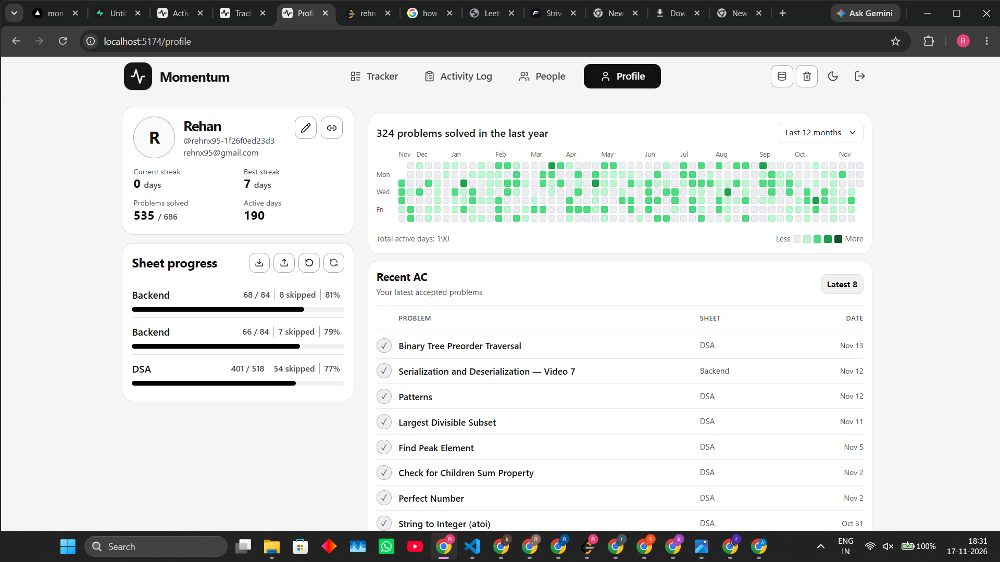

# Momentum
 
**A personal workspace for learning, daily routines, and visible progress.**
 
[](https://github.com/rehnx95/Momentum/actions/workflows/ci.yml)
 
[Open the live app](https://momentum-rehnx.vercel.app/)
 
Momentum brings learning tracks, time tracking, and progress insights into one
account-based workspace. Follow a built-in track, bring your own `.txt` track,
log your activities and sleep, then review your history and habits over time.
It installs as a progressive web app and keeps working through short
connection drops.
 
## What you can do
 
- **Learn with structure.** Mark problems `To do`, `Done`, or `Skipped`. Start
  with the built-in **DSA** (518 items, with LeetCode links and difficulty) and
  **Backend** (84 items) tracks, or upload your own `.txt` track. Search,
  filter, and expand or collapse groups as you work.
- **Record your day.** Log timed activities with start/end slots, run a live
  timer, and record sleep. Daily Log autosaves, warns about overlapping or
  invalid time, and lets you pick a color for each activity.
- **Review your history.** Full Log shows every day as a share-of-time bar
  (activities, sleep, and untracked time). Trends charts sleep and activity
  hours over 7- or 30-day windows and totals where a week went.
- **See your progress.** Completion totals, current and best streaks, a
  one-year or per-year activity heatmap, recent accepted problems, and
  per-track progress.
- **Share a profile.** Find other Momentum users by username and open their
  profile. Public profiles are visible to signed-in users and include the
  owner's **email address**, name, username, progress summaries, and activity.
- **Move your progress.** Export and import problem states for a track, reset a
  single track, or restore the original DSA track.
- **Sign in your way.** Google, email and password, or username and password.
- **Work offline.** Progress, Daily Log, and activity-color changes are saved on
  the device and sync when you reconnect.
## Screenshots
 
| DSA tracker (dark) | DSA tracker (light) |
| --- | --- |
|  |  |
 
| Expanded DSA tracker (dark) | Expanded DSA tracker (light) |
| --- | --- |
|  |  |
 
| Backend tracker (dark) | Backend tracker (light) |
| --- | --- |
|  |  |
 
| Daily Log (dark) | Daily Log (light) |
| --- | --- |
|  |  |
 
| Full Log (dark) | Full Log (light) |
| --- | --- |
|  |  |
 
| Profile (dark) | Profile (light) |
| --- | --- |
|  |  |
 
More views are in [`docs/screenshots/`](./docs/screenshots/).
 
## Technology
 
| Layer | Technologies |
| --- | --- |
| Web app | React 18, JavaScript (ES modules), Tailwind CSS, component-scoped CSS |
| Build | Vite 5 |
| Identity and database | Supabase Auth, PostgreSQL, PostgREST, row-level security, SQL functions |
| Hosting and API | Vercel static hosting and serverless functions |
| Offline | Service worker, IndexedDB outbox, `localStorage` caches, web app manifest |
| Quality checks | Vitest, Testing Library, ESLint, Prettier, GitHub Actions |
| Icons | Lucide React |
 
## Run locally
 
**Requirements:** Node.js 22 or newer, npm, and a Supabase project (needed for
sign-in and every account-backed feature).
 
```powershell
Copy-Item .env.example .env
npm ci
npm run dev
```
 
Fill in `.env`:
 
```dotenv
VITE_SUPABASE_URL=https://your-project.supabase.co
VITE_SUPABASE_PUBLISHABLE_KEY=sb_publishable_your-key
# Server-side only (Vercel API routes). Never prefix this key with VITE_.
SUPABASE_SERVICE_ROLE_KEY=
```
 
Open the URL Vite prints (normally `http://localhost:5173`). Then:
 
1. Apply every SQL file in `supabase/migrations/` in filename order.
2. Enable the **Google** and **Email** providers in Supabase Auth and add your
   local and deployed origins to the allowed redirect URLs.
Vite serves only the frontend. Email sign-up, username sign-in, and username
search are Vercel functions, so to use them locally set
`SUPABASE_SERVICE_ROLE_KEY` and run `npx vercel dev` instead of `npm run dev`.
The [architecture guide](./docs/architecture.md#9-local-development-and-deployment)
has the full setup and deployment steps.
 
## Commands
 
| Command | Purpose |
| --- | --- |
| `npm run dev` | Start the Vite development server |
| `npm run dev:test` | Start the test-mode server on port 5174 (sample-data tools) |
| `npm run build` | Create the production bundle in `dist/` |
| `npm run preview` | Serve the production bundle locally |
| `npm test` | Run the Vitest suite |
| `npm run lint` | Check JavaScript and JSX with ESLint |
| `npm run format` | Format the repository with Prettier |
| `npm run convert-sheet -- dsa` | Convert `source/dsa.txt` into its bundled JSON track |
| `npm run create-links` | Regenerate `dsa.md`, LeetCode links, and difficulties from `source/dsa.txt` |
| `npm run verify-links` | Check every LeetCode link and difficulty against LeetCode and write `link_review.txt` |
 
## Built-in tracks
 
Built-in tracks are plain text in `source/`. Edit a source, regenerate its JSON,
and commit both:
 
```powershell
npm run convert-sheet -- dsa
npm run create-links     # DSA only: links and difficulty maps
npm run verify-links     # optional: audit the links
```
 
Existing accounts receive updated problem titles and LeetCode IDs on their next
sign-in, matched by stable problem ID, and their saved progress is preserved.
Apply the matching Supabase migrations when you ship a metadata change. See

## Install as an app
 
Momentum is an installable PWA. Use your browser's **Install** option (or add it
to the home screen on mobile). After one online sign-in on a device, the app
shell opens offline and your changes queue locally until the connection returns.
Sign-in, search, sheet management, and public profiles need a connection.
 
## Sample-data mode
 
Sample-data controls exist only in the local test-mode development server. Use a
**dedicated test account** and check the signed-in email before seeding or
removing data. Test mode uses the Supabase project in `.env`; it does not create
an isolated database.
 
```powershell
Copy-Item .env.test.example .env.test.local
npm run dev:test
```
 
Sign in at `http://localhost:5174` (add that origin to Supabase's allowed
redirect URLs if you use Google). Seeding writes Daily Log, problem-progress,
and activity rows; removing deletes those rows for the signed-in account and
leaves its profile and tracks intact.
 
## Project structure
 
```text
api/                       Vercel functions: username search, sign-up, username sign-in
docs/
  architecture.md          System design, data flows, security, and operations
  screenshots/             Product screenshots
  archive/                 Development history
public/                    Manifest, service worker, icons, offline assets
scripts/                   Track conversion and LeetCode link tooling
source/                    Editable text sources for built-in tracks
src/
  features/
    activity/              Heatmap and sleep/activity charts
    auth/                  Sign-in, onboarding, session lifecycle
    daily-log/             Daily Log, Full Log, Trends, timers, persistence
    dashboard/             Signed-in app composition and tracker screen
    people/                Username search and public profiles
    problem-tracker/       Problem tree, filters, progress persistence
    profile/               Owner profile, metrics, backup, settings
    sheets/                Built-in and uploaded tracks
    testing/               Test-mode sample-data tools
  pwa/                     Install, launch, and sync integration
  shared/                  Reusable UI, Supabase client, caches, offline sync, utilities
  styles/                  Global tokens, layout, themes, responsive styles
supabase/migrations/       Ordered PostgreSQL schema, policy, and function changes
```
 
Feature behavior lives under `src/features/<feature>/`; code moves to
`src/shared/` only when more than one feature uses it.
 
## Documentation
 
- [Architecture and operations](./docs/architecture.md)
- [Learning-track sources](./source/)
- [Development history](./docs/archive/commit-history.md)
## License
 
No license is declared in this repository. Contact the repository owner before
redistributing or reusing the code.
 