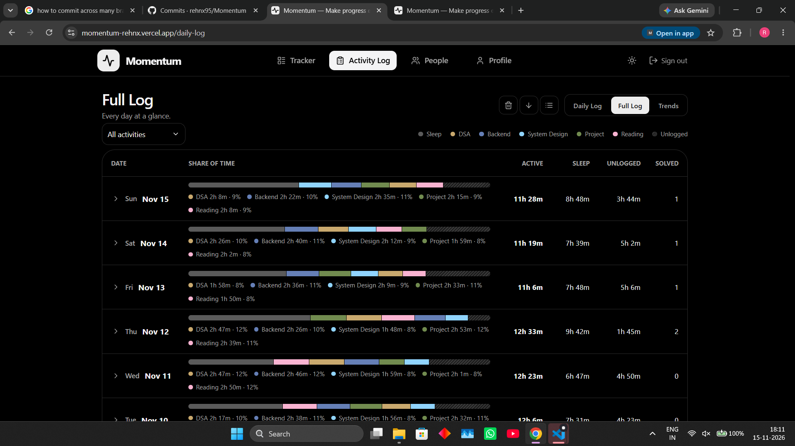
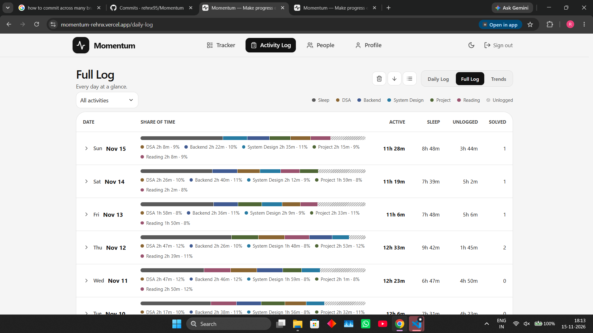
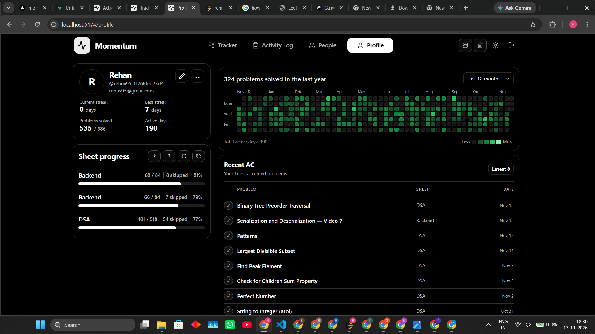

# Momentum

**A personal workspace for learning, daily routines, and visible progress.**

[](https://github.com/rehnx95/Track-Sheet/actions/workflows/ci.yml)

[Open the live app](https://momentum-rehnx.vercel.app/)

Momentum brings learning tracks, time tracking, and progress insights into one
account-based workspace. Follow a built-in track, bring your own `.txt` track,
log activities and sleep, then review your history and habits over time.

## What you can do

- **Learn with structure.** Track problems through `To do`, `Done`, and
  `Skipped` states. Start with the built-in DSA and Backend tracks or upload
  your own text-based track. Tracker changes can be saved offline and synced
  when the connection returns.
- **Record your day.** Log timed activities and sleep. Daily Log autosaves and
  can keep edits made offline on this device until the connection returns;
  previously loaded history remains available from its cache.
- **See your progress.** Use completion totals, streaks, recent accepted
  problems, activity heatmaps, and sleep/study summaries.
- **Share a profile.** Find other Momentum users by username and open their
  profile. Public profiles are available to signed-in users and currently
  include the owner's email address, profile identity, progress summaries,
  and activity history.
- **Move your progress.** Export and restore problem states for a selected
  track.

## Screenshots

| DSA tracker (dark) | DSA tracker (light) |
| --- | --- |
|  |  |

| Expanded DSA tracker (dark) | Expanded DSA tracker (light) |
| --- | --- |
|  |  |

| Backend tracker (dark) | Backend tracker (light) |
| --- | --- |
|  |  |

| Daily Log (dark) | Daily Log (light) |
| --- | --- |
|  |  |

| Full Log (dark) | Full Log (light) |
| --- | --- |
|  |  |

| Profile (dark) | Profile (light) |
| --- | --- |
|  |  |

More views and light-theme screenshots are in [`docs/screenshots/`](./docs/screenshots/).

## Technology

| Layer | Technologies |
| --- | --- |
| Web app | React 18, JavaScript, Tailwind CSS, component-scoped CSS |
| Build | Vite 5 |
| Identity and database | Supabase Auth, PostgreSQL, PostgREST, row-level security, SQL functions |
| Hosting and API | Vercel static hosting and serverless functions |
| Quality checks | Vitest, Testing Library, ESLint, GitHub Actions |
| Icons | Lucide React |

## Run locally

**Requirements:** Node.js 20 and npm; a Supabase project is needed for
authentication and account-backed features.

```powershell
Copy-Item .env.example .env
npm ci
npm run dev
```

Set these values in `.env` before using the app:

```dotenv
VITE_SUPABASE_URL=https://your-project.supabase.co
VITE_SUPABASE_PUBLISHABLE_KEY=sb_publishable_your-key
```

Open the Vite URL printed in the terminal (normally `http://localhost:5173`).
Apply the SQL migrations in `supabase/migrations/`, enable Google and Email as
Supabase Auth providers, and configure the Google callback and allowed redirect
URLs. Set `SUPABASE_SERVICE_ROLE_KEY` in Vercel for account creation and
username sign-in; keep it server-side and never expose it with a `VITE_` prefix. The
[architecture guide](./docs/architecture.md#local-development-and-deployment)
has the complete setup and deployment steps.

Vite serves the frontend, but not the Vercel APIs. To exercise account creation,
username sign-in, or username search locally, set `SUPABASE_SERVICE_ROLE_KEY` in your local
environment and run the app with `npx vercel dev`.

## Commands

| Command | Purpose |
| --- | --- |
| `npm run dev` | Start the Vite development server |
| `npm run build` | Create the production bundle in `dist/` |
| `npm run preview` | Serve the production bundle locally |
| `npm test` | Run the Vitest suite |
| `npm run lint` | Check JavaScript and JSX with ESLint |
| `npm run convert-sheet -- dsa` | Convert `source/dsa.txt` into its bundled JSON track |

## Built-in track updates

Edit a built-in track's source in `source/` and regenerate its JSON before
committing both files. Existing accounts receive supported title and
LeetCode-link metadata updates by stable problem ID on their next successful
sign-in bootstrap; saved progress is preserved. Apply the corresponding
Supabase migrations when deploying metadata-sync changes. See the
[architecture guide](./docs/architecture.md#built-in-track-maintenance) for
the update flow.

## Sample-data mode

Sample-data controls are available only in the local test-mode development
server. Use a **dedicated test account** and verify the signed-in email before
seeding or removing data. Test mode uses the Supabase project configured in
`.env`; it does not create an isolated database.

```powershell
Copy-Item .env.test.example .env.test.local
npm run dev:test
```

Sign in at `http://localhost:5174` with the test account. To use Google OAuth
on this origin, add it to Supabase Auth's allowed redirect URLs. Removing
sample data deletes that account's Daily Log, problem-progress, and activity
history rows; it leaves the profile and learning tracks intact.

## Project structure

```text
api/                      Username search and password sign-in functions
docs/
  architecture.md         System design, data flows, security, and operations
  screenshots/            Product screenshots
  archive/                 Supporting project history
scripts/                   Built-in track conversion
source/                    Editable text sources for bundled tracks
src/
  features/
    activity/              Heatmap and sleep/study charts
    auth/                  Sign-in, onboarding, and session lifecycle
    daily-log/             Daily Log, Full Log, Trends, and persistence
    dashboard/             Signed-in app composition and tracker controls
    people/                Username search and public profiles
    problem-tracker/       Learning-track problem state and navigation
    profile/               Owner profile, metrics, and progress backup
    sheets/                Built-in and uploaded learning tracks
    testing/               Local test-mode sample-data tools
  shared/                  Reusable UI, Supabase client, cache, date, and time helpers
  styles/                  Global layout, themes, and responsive styles
supabase/migrations/        Ordered PostgreSQL schema and policy changes
```

Feature behavior belongs under `src/features/<feature>/`; code moves to
`src/shared/` when it is genuinely reused. See the [architecture guide](./docs/architecture.md)
for runtime boundaries, data ownership, and maintenance rules.

## Documentation

- [Architecture and operations](./docs/architecture.md)
- [Learning-track source files](./source/)
- [Development history](./docs/archive/commit-history.md)

## License

No license is currently declared in this repository. Contact the repository
owner before redistributing or reusing the code.
