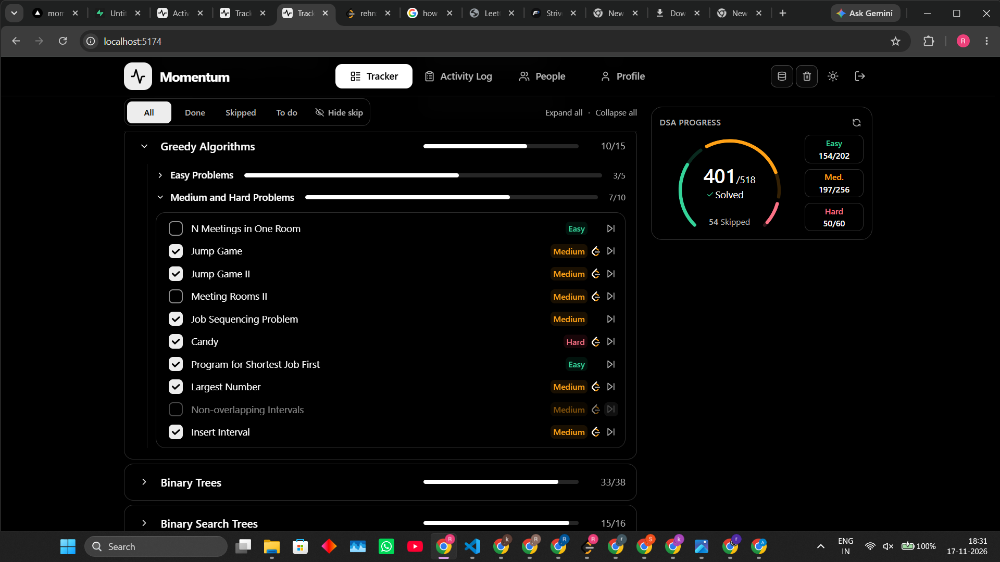
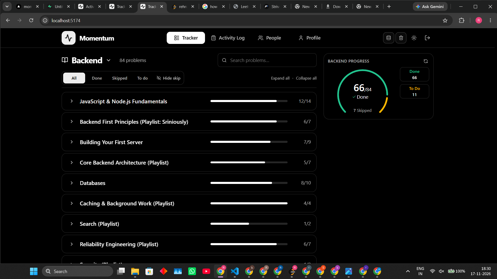
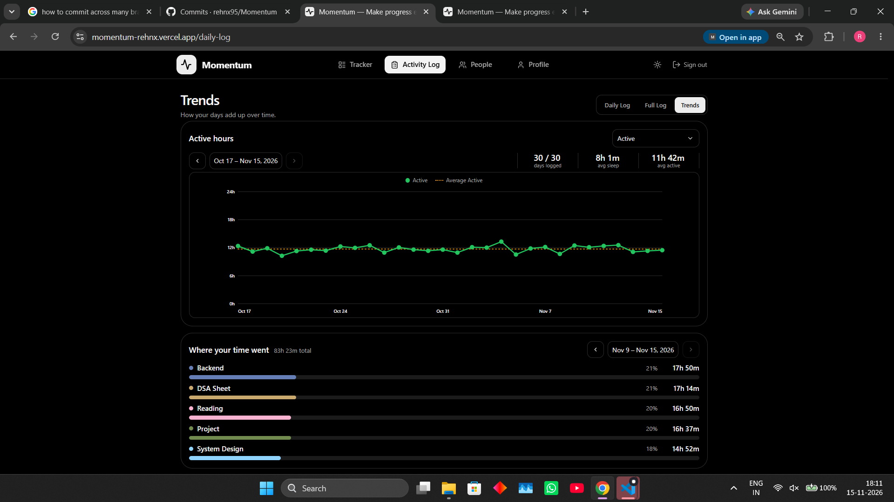
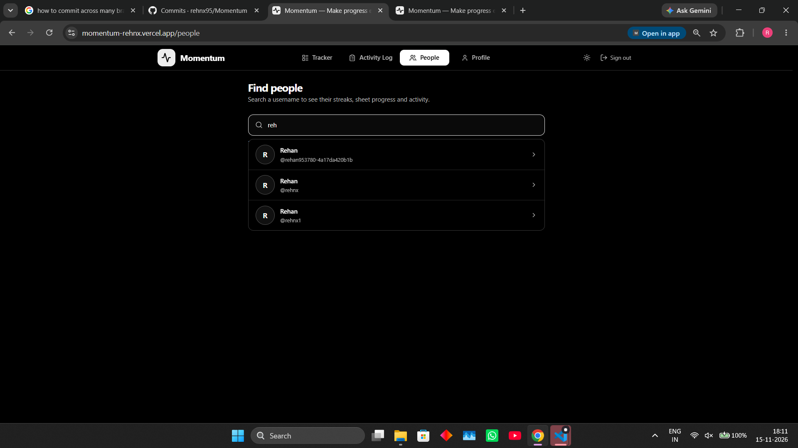

# Momentum

### Learn, track your days, and see progress—all in one place.

Momentum is a personal progress workspace for coding practice and everyday
routines. Track what you are learning, record how you spend your time, and use
your history to understand how your efforts add up.

[**Try Momentum**](https://momentum-rehnx.vercel.app/) ·
[Explore the features](#product-overview) ·
[Read the architecture guide](./docs/architecture.md)

[](https://github.com/rehnx95/Momentum/actions/workflows/ci.yml)

## Product overview

### Learning tracks and problem solving

Start with the built-in **DSA roadmap (514 problems across 18 steps)** or the
**Backend roadmap (153 problems across 14 steps)**. You can also upload a
plain-text problem sheet and keep progress for each track separately.

- Use available practice, article, YouTube, and LeetCode links directly from
  problem rows; difficulty is labeled Easy, Medium, or Hard.
- Mark a problem Done or Skipped independently. The title opens its practice
  page when available; the checkbox changes completion.
- Find problems with search and status filters, hide skipped items, and expand
  or collapse roadmap sections.
- See solved and skipped totals, plus Easy/Medium/Hard progress for the built-in
  DSA track. Import or export progress, reset a track, or restore DSA.

### Daily routines and time tracking

Use **Daily Log** to record study, work, exercise, sleep, and other activities.
Add start/end time slots, run a live timer, use quick-log actions for learning
tracks, and choose colors to make activities easy to scan. The log autosaves,
validates times, and warns about overlaps.

### History and progress insights

- **Full Log** brings past days together in a time breakdown of activities,
  sleep, and untracked time.
- **Trends** compares sleep and activity over 7- or 30-day periods and shows
  averages and weekly totals.
- The tracker dashboard shows solved, to-do, skipped, and difficulty-level
  progress. Profiles add current and best streaks, recent accepted problems,
  and yearly activity heatmaps.

### Profiles and sharing

Sign in with Google, email/password, or username/password. Your profile brings
together your track progress and activity; username search helps signed-in
users find other Momentum members and view their public progress profiles.

### Offline and personal settings

Install Momentum as a PWA on desktop or mobile. After signing in online, progress
and Daily Log changes can be saved on the device and synced after reconnecting.
Choose a theme and activity colors, and use the feedback control to open a
pre-addressed Gmail draft.

## Screenshots

| DSA tracker (light) | Expanded track (dark) |
| --- | --- |
|  |  |

| Backend track (dark) | Daily Log (light) |
| --- | --- |
|  |  |

| Full Log (dark) | Trends (dark) |
| --- | --- |
|  |  |

| Profile (light) | People search (dark) |
| --- | --- |
|  |  |

More views and light/dark variants are in [`docs/screenshots/`](./docs/screenshots/).

## Engineering highlights

- **Feature-based React architecture** keeps tracker, Daily Log, profiles, and
  authentication code organized by product area.
- **Responsive, installable experience** uses route-level code splitting and a
  service worker for app-shell caching.
- **Offline-aware persistence** queues local changes, syncs them on reconnect,
  and surfaces conflicts instead of silently overwriting newer data.
- **Secure data boundaries** use Supabase Auth, PostgreSQL row-level security,
  and server-side functions for username search and sign-in.
- **Tested workflows** use Vitest and Testing Library for unit, component, and
  integration coverage, with ESLint for static checks.

For system design, data flows, security boundaries, and deployment details, see
the [architecture guide](./docs/architecture.md).

## Technology
 
| Layer | Technologies |
| --- | --- |
| Web app | React 18, JavaScript (ES modules), Tailwind CSS, shared and feature-specific CSS |
| Build | Vite 5 |
| Identity and database | Supabase Auth, PostgreSQL, PostgREST, row-level security, SQL functions |
| Hosting and API | Vercel static hosting and serverless functions |
| Offline | Service worker, IndexedDB outbox, `localStorage` caches, web app manifest |
| Quality checks | Vitest, Testing Library, ESLint, Prettier, GitHub Actions |
| Icons | Lucide React |
 
## Run locally
 
**Requirements:** Node.js 22 or newer, npm, and a Supabase project (needed for
sign-in and every account-backed feature).
 
```powershell
Copy-Item .env.example .env
npm ci
npm run dev
```
 
Fill in `.env`:
 
```dotenv
VITE_SUPABASE_URL=https://your-project.supabase.co
VITE_SUPABASE_PUBLISHABLE_KEY=sb_publishable_your-key
# Server-side only (Vercel username-login API). Never prefix this key with VITE_.
SUPABASE_SERVICE_ROLE_KEY=
```
 
Open the URL Vite prints (normally `http://localhost:5173`). Then:
 
1. Apply every SQL file in `supabase/migrations/` in filename order.
2. Enable the **Google** and **Email** providers in Supabase Auth and add your
   local and deployed origins to the allowed redirect URLs. Enable email
   confirmations and configure production email delivery before public launch.
Vite serves only the frontend. Email/password sign-up uses Supabase Auth
directly. Username sign-in and search need Vercel functions, so run
`npx vercel dev` locally to use them; only username sign-in needs
`SUPABASE_SERVICE_ROLE_KEY`.
The [architecture guide](./docs/architecture.md#9-local-development-and-deployment)
has the full setup and deployment steps.
 
## Commands
 
| Command | Purpose |
| --- | --- |
| `npm run dev` | Start the Vite development server |
| `npm run dev:test` | Start the test-mode server on port 5174 (sample-data tools) |
| `npm run build` | Create the production bundle in `dist/` |
| `npm run preview` | Serve the production bundle locally |
| `npm test` | Run the Vitest suite |
| `npm run lint` | Check JavaScript and JSX with ESLint |
| `npm run format` | Format the repository with Prettier |
| `npm run convert-sheet -- dsa` | Convert `source/dsa.txt` into its bundled JSON track |
| `npm run convert-sheets` | Convert every `.txt` track in `source/` into JSON |
| `npm run create-links` | Refresh DSA LeetCode links and difficulty metadata after DSA changes |
| `npm run verify-links` | Check every LeetCode link and difficulty against LeetCode and write `link_review.txt` |
 
## Built-in tracks
 
Built-in tracks are plain text in `source/`. Edit one or both sources, then run
one command to regenerate every bundled JSON:
 
```powershell
npm run convert-sheets
npm run create-links     # DSA only: refresh links and difficulty metadata
npm run verify-links     # optional: audit the links
```
 
The converter keeps existing IDs matched to LeetCode problem IDs (or titles for
unlinked items), so reordering source rows does not move saved progress. Commit
the updated JSON with its source. See the [architecture guide](./docs/architecture.md#9-local-development-and-deployment)
for deployment and existing-user sync details.

## Install as an app
 
Momentum is an installable PWA. Use your browser's **Install** option (or add it
to the home screen on mobile). After one online sign-in on a device, the app
shell opens offline and your changes queue locally until the connection returns.
Sign-in, search, sheet management, and public profiles need a connection.
 
## Sample-data mode
 
Sample-data controls exist only in the local test-mode development server. Use a
**dedicated test account** and check the signed-in email before seeding or
removing data. Test mode uses the Supabase project in `.env`; it does not create
an isolated database.
 
```powershell
Copy-Item .env.test.example .env.test.local
npm run dev:test
```
 
Sign in at `http://localhost:5174` (add that origin to Supabase's allowed
redirect URLs if you use Google). Seeding writes Daily Log, problem-progress,
and activity rows; removing deletes those rows for the signed-in account and
leaves its profile and tracks intact.
 
## Project structure
 
```text
api/                       Vercel functions: username search and username sign-in
docs/
  architecture.md          System design, data flows, security, and operations
  screenshots/             Product screenshots
  archive/                 Development history
public/                    Manifest, service worker, icons, offline assets
scripts/                   Track conversion and LeetCode link tooling
source/                    Editable text sources for built-in tracks
src/
  features/
    activity/              Heatmap and sleep/activity charts
    auth/                  Sign-in, onboarding, session lifecycle
    daily-log/             Daily Log, Full Log, Trends, timers, persistence
    dashboard/             Signed-in app composition and tracker screen
    people/                Username search and public profiles
    problem-tracker/       Problem tree, filters, progress persistence
    profile/               Owner profile, metrics, backup, settings
    sheets/                Built-in and uploaded tracks
    testing/               Test-mode sample-data tools
  pwa/                     Install, launch, and sync integration
  shared/                  Reusable UI, Supabase client, caches, offline sync, utilities
  styles/                  Shared styles; route-specific styles load with screens
supabase/migrations/       Ordered PostgreSQL schema, policy, and function changes
```
 
Feature behavior lives under `src/features/<feature>/`; code moves to
`src/shared/` only when more than one feature uses it.
 
## Documentation
 
- [Architecture and operations](./docs/architecture.md)
- [Learning-track sources](./source/)
- [Development history](./docs/archive/commit-history.md)
## License
 
No license is declared in this repository. Contact the repository owner before
redistributing or reusing the code.
 