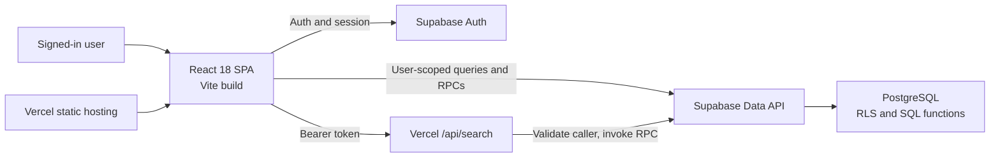

# Momentum | Architecture and Operations

Momentum is a multi-user progress workspace built as a React single-page
application with Supabase-backed identity and data. This guide describes the
system boundaries, where each behavior belongs, how data moves through the
application, and how to develop and deploy it.

## System overview



The browser never connects directly to PostgreSQL. Supabase Auth provides the
user session; the Supabase Data API applies row-level security (RLS) to
database operations. The Vercel search function validates the caller's
bearer token and makes the same constrained profile-search call on that
user's behalf.

| Boundary | Responsibility |
| --- | --- |
| React application | Screens, interaction state, client-side validation, and feature-level data requests. |
| Supabase Auth | Google OAuth, session restoration, and identity. |
| PostgreSQL | Profiles, personal learning tracks, problem progress, activity counts, and daily logs. |
| RLS and SQL functions | Enforce account ownership and provide narrowly scoped profile operations. |
| Vercel | Serve the built SPA, rewrite app routes, and run `api/search.js`. |
| Browser storage | Keep preferences and account-scoped caches for the current browser; it is not the cross-device source of truth. |

## Repository map

Code is grouped by product area. A feature owns its screens, hooks, and
domain-specific styles; `src/shared/` contains only code reused across
features.

```text
src/
  App.jsx                 Auth-state entry point
  main.jsx                React root and global styles
  features/
    activity/             Activity heatmap and sleep/study charts
    auth/                 Sign-in, onboarding, and authentication state
    daily-log/
      components/         Day and Full Log UI, inputs, cards, and styles
      hooks/              Log editing, persistence, history, and timers
      lib/                Daily-log model and cache
    dashboard/            Signed-in screen composition and tracker controls
    people/               People search and public profile screens
    problem-tracker/      Problem tree, progress, and filtering
    profile/              Profile screens, metrics, and progress backup
    sheets/               Track library, templates, and TXT parsing
    testing/              Test-mode-only sample data tools
  shared/
    components/           Reusable interface components
    lib/                  Supabase client and generic browser cache
    utils/                Date and time calculations
  styles/                 Global tokens, layout, and responsive styles
api/search.js             Authenticated username-search endpoint
source/                   Editable source text for bundled tracks
supabase/migrations/      Database schema, policies, and SQL functions
```

### Ownership map

| Area | Entry points | Owns |
| --- | --- | --- |
| Authentication | `src/App.jsx`, `src/features/auth/useAuthentication.js` | Session lifecycle, sign-in, onboarding, and auth-screen selection. |
| Signed-in application | `src/features/dashboard/AuthenticatedApp.jsx`, `AuthenticatedScreens.jsx` | Compose feature hooks and select the active screen. |
| Learning tracks | `src/features/sheets/hooks/useSheetLibrary.js`, `src/features/sheets/utils/parseSheet.js` | Load built-in templates, manage personal copies, and import text tracks. |
| Problem progress | `src/features/problem-tracker/hooks/useProgress.js`, `useProblemTree.js` | Persist problem states and derive the searchable, filterable problem tree. |
| Daily Log | `src/features/daily-log/hooks/useDailyLog.js` | Compose the daily editing, persistence, history, and timer hooks. |
| Profiles and people | `src/features/profile/`, `src/features/people/`, `src/features/dashboard/usePeopleNavigation.js` | Owner profile metrics, public profile views, search, and profile navigation. |
| Activity analytics | `src/features/activity/` | Activity heatmaps and sleep/study charts. |
| Test data | `src/features/testing/` | Generate isolated sample history from the test-mode development server. |
| Shared platform code | `src/shared/` | Supabase client, generic cache, common UI, and cross-feature date/time helpers. |

The Daily Log keeps styles close to the components they describe:
`CustomDatePicker.css` styles the date picker, `TimeInput.css` styles the
segmented time field, `ActivityEditor.css` styles activity cards and slots,
and `FullLog.css` styles history and log summaries. Responsive styles remain
separate when a component needs viewport or container-specific rules.

Global styles are imported from `src/main.jsx`. Preserve import order when
moving CSS: theme overrides and component selectors can depend on the
cascade.

## Runtime and routes

### Startup

1. `src/main.jsx` mounts `App` inside a React error boundary and imports the
   global styles.
2. `src/shared/lib/supabase.js` creates the browser client from
   `VITE_SUPABASE_URL` and `VITE_SUPABASE_PUBLISHABLE_KEY`.
3. `useAuthentication` restores a cached account view, validates the current
   Supabase session, and observes authentication changes.
4. The authentication state selects sign-in, onboarding, or the signed-in
   application.
5. The signed-in app loads the user's learning tracks before requesting
   track-specific progress.

The client distinguishes loading, signed-out, onboarding, and signed-in
states. People search, public profiles, settings, and Daily Log are
authenticated screens within the signed-in application.

### Client routes

Navigation uses the browser History API and a `popstate` listener rather than
a routing package. `usePeopleNavigation` owns route state, history updates,
people search, and public-profile loading; `AuthenticatedScreens` maps that
state to screen components.

| Path | Screen | Access |
| --- | --- | --- |
| `/` | Sign-in, onboarding, or tracker workspace based on account state | Workspace requires sign-in |
| `/profile` | Owner profile and progress | Sign-in required |
| `/profile/edit` | Profile settings | Sign-in required |
| `/daily-log` | Day view and Full Log | Sign-in required |
| `/people` | Username search | Sign-in required |
| `/user/:username`, `/u/:username` | Curated profile view | Sign-in required |
| `/api/search?q=<prefix>` | Vercel search function | Valid bearer token required |

`vercel.json` sends app routes to `index.html`; `/api/search` is handled by
the serverless function.

## Feature and data flows

### Learning tracks

Built-in track templates live in `src/features/sheets/data/` as JSON.
Maintained text sources live in `source/` and are converted with
`npm run convert-sheet`. A template filename supplies its track ID.

On sign-in, `bootstrapBuiltInSheets.js` sends the available templates to
`ensure_builtin_sheet_copies`. The database creates per-user copies; later
template edits do not overwrite existing user content or progress.

Users can also upload `.txt` files up to 2 MB. `parseSheet.js` validates and
normalizes numbered steps, optional subsections, problem titles, external
problem numbers, and default-skip markers. The parsed data is stored in
`user_sheets`. Deletion goes through the ownership-checking
`delete_user_sheet` function so related progress and activity counts can be
cleaned up safely.

Database-backed tracks receive a user-sheet UUID and a namespaced frontend
ID. Problem IDs include the track ID, preventing collisions between tracks
that reuse local problem identifiers.

### Problem progress

Problem states are `todo`, `done`, or `skipped`. A missing row is treated as
`todo`, except where a template defines a default skipped state and the user
has not saved an override.

`useProgress` reads the user's saved progress and activity counts, consulting
an account-scoped cache first. A state change updates the UI optimistically,
then queues the corresponding database writes to preserve order during rapid
updates. Errors are surfaced to the user. This is not a durable offline
queue; pending writes are not guaranteed to survive a closed browser.

When a problem is completed, the client stores a local `completed_on` date
and an `updated_at` timestamp. The owner's heatmap and streaks use
`activity_log`; public activity is derived from completed progress records
through SQL functions. These separate sources can differ if counts have
drifted.

### Daily Log

`useDailyLog` composes focused hooks for activity editing, persistence,
history, and timer behavior. Daily records contain sleep/wake times and
activity slots.

1. Initialize the selected day from the account-scoped browser cache when
   available.
2. Fetch that user's `daily_logs` row.
3. Update React state and its synchronous ref when the user edits a field,
   activity, or slot.
4. Validate sleep and activity intervals with
   `src/shared/utils/time.js`.
5. Debounce valid changes, serialize writes, and upsert the day record.
6. Flush pending edits before date changes or history-clearing operations.

Full Log data loads on demand. The history hook caches results for one minute,
loads ten rows per page plus one extra to detect older records, and
coordinates history clearing with pending day saves.

The timer hook persists active timer details per account and splits intervals
at midnight so that each segment is assigned to the correct date. Daily-log
preferences and caches are browser-specific; they do not automatically sync
between devices.

The owner-only sleep/study chart reads the latest 30 days of `daily_logs`,
calculates durations, and renders SVG charts sized with `ResizeObserver`.
Detailed daily-log records are not included in public profile responses.

### Profiles and people search

The owner profile combines profile fields with sheet-level progress,
streaks, recent accepted problems, and activity visualizations. Profile
metrics and progress backup are isolated in hooks under `src/features/profile/`.

Public profile routes require a signed-in user. “Public” means visible to
other authenticated Momentum users, not anonymous visitors. The client calls
`get_public_profile` and `get_public_activity`; these SQL functions return
curated fields rather than raw profile, account, or uploaded-sheet data.
Profile responses are cached in memory by username.

Progress exports contain explicit `done` and `skipped` states for a selected
track. Imports validate the file and match problems by namespaced ID, local
ID/title, or an unambiguous normalized title; unmatched and ambiguous items
are not applied.

## Data model

Timestamped SQL files under `supabase/migrations/` define the schema, indexes,
policies, and RPCs.

| Table | Purpose |
| --- | --- |
| `profiles` | Account profile, unique username, onboarding status, and optional public profile fields. |
| `user_sheets` | Per-user learning-track content and source metadata. |
| `progress` | Explicit problem states and completion timestamps, keyed by user and namespaced problem ID. |
| `activity_log` | Per-user completion counts by date. |
| `daily_logs` | Per-user sleep/wake times and JSON activity slots, keyed by user and date. |
| `user_deleted_builtin_sheets` | Per-user tombstones that prevent a deleted built-in copy from being recreated. |
| `user_settings` | Legacy owner-scoped settings table; active tracker preferences are stored in browser storage. |

Foreign keys cascade account-owned data when an account is removed. Indexes
support user/date history, progress lookup, unique built-in copies, and
username prefix search.

## Security and privacy

- RLS protects account-owned table rows using `auth.uid()`.
- Cross-user profile discovery uses purpose-specific SQL functions with
  limited return fields, not broad profile-table reads.
- The search endpoint validates the bearer token with Supabase Auth and uses
  the caller's token for the search RPC. It does not use a service-role key.
- Public profile responses must not include email, Auth IDs, private
  settings, pending work, or raw uploaded-sheet JSON.
- Browser-exposed Supabase configuration uses the publishable key. Never put
  a secret or service-role key in frontend code or a `VITE_` variable.

Important RPCs include `is_username_available`,
`search_public_profiles`, `get_public_profile`, `get_public_activity`,
`ensure_builtin_sheet_copies`, and `delete_user_sheet`. Their exact
signatures and grants are defined by the migrations.

## Username-search API

`GET /api/search?q=<prefix>` is implemented in `api/search.js`. It:

1. accepts GET requests and applies `private, no-store` caching;
2. validates a 3–48 character alphanumeric/hyphen prefix;
3. requires a bearer token and validates it with Supabase Auth;
4. invokes `search_public_profiles` using the caller's token; and
5. returns at most five `{ username, name }` matches.

The endpoint uses `VITE_SUPABASE_URL` and
`VITE_SUPABASE_PUBLISHABLE_KEY`, configured for both the Vercel build and
function runtime.

## Local development and deployment

### Local setup

Requirements: Node.js, npm, and a Supabase project.

```powershell
Copy-Item .env.example .env
npm install
npm run dev
```

Set `VITE_SUPABASE_URL` and `VITE_SUPABASE_PUBLISHABLE_KEY` in `.env`. Vite
serves the application on port `5173` by default. `npm run dev` serves the
frontend only; use `npx vercel dev` when testing `/api/search` locally.

### Validate changes

```bash
npm test
npm run build
npm run preview
```

Vitest covers shared time logic, caching, Daily Log history, time input, and
Full Log timeline behavior. No lint or end-to-end test command is currently
configured in `package.json`.

### Configure Supabase

For a new project:

1. Apply every migration in `supabase/migrations/` in filename order. For an
   existing project, apply only migrations not already recorded as applied.
2. Configure Google as an Auth provider in Supabase.
3. Add the Supabase callback URL shown in the provider settings to Google's
   authorized redirect URIs.
4. Set the Supabase Auth Site URL to the production URL and add local,
   production, and any intended Vercel Preview URLs to the allowed redirect
   list.

Reuse the existing Supabase project to preserve its accounts and data. Never
rerun applied migrations on a live database.

### Deploy to Vercel

The project uses the Vite preset, `npm run build`, and `dist` as the output
directory. Set `VITE_SUPABASE_URL` and
`VITE_SUPABASE_PUBLISHABLE_KEY` in the Vercel project for the build and
function runtime. After deployment, add the production URL to Supabase Auth
redirect configuration and Google's authorized JavaScript origins.

The current deployment is [momentum-rehnx.vercel.app](https://momentum-rehnx.vercel.app/).
Changes pushed to the connected GitHub branch deploy through Vercel. Redeploy
after changing environment variables so the new values are applied.

## Migration history

Migrations are append-only schema history; do not edit or replay a migration
that has already been applied to a shared database. The timestamped files
cover these areas:

- **Accounts and progress:** profiles, signup behavior, completion dates,
  activity counts, and owner policies.
- **Learning tracks:** private uploads, personal copies of built-in tracks,
  deletion tombstones, namespaced progress migration, and safe deletion.
- **People and profiles:** authenticated username search, curated profile
  data, and year-selectable activity.
- **Daily Log:** daily records, legacy interval migration, user/date lookup,
  and data sanity constraints.

The SQL files are authoritative for exact table definitions and function
signatures.

## Troubleshooting

| Symptom | First checks |
| --- | --- |
| Supabase is not configured | Set both Vite environment variables and restart the development server. |
| Google sign-in fails | Check the Supabase provider, Google callback URL, Site URL, and allowed redirects. |
| Built-in or uploaded tracks fail to load | Confirm the track migrations and owner policies are applied. |
| Progress does not sync | Inspect the visible sync error, browser console, network request, and RLS policies. |
| Daily Log cannot load or save | Check the daily-log migration, owner policy, requested date, and database error. |
| People search fails | Check Vercel function environment, bearer token, prefix format, and search RPC grants. |
| Deep link fails after refresh | Confirm Vercel's SPA rewrite and `/api/search` function are both deployed. |
| Owner and public heatmaps differ | Compare `activity_log` counts with progress completion dates. |
| A built-in track update is not visible to an existing user | Existing personal copies are intentionally not overwritten by template bootstrap. |

## Maintenance boundaries

- Keep feature-specific behavior inside its owning `src/features/` area;
  promote code to `src/shared/` only when it is genuinely reused.
- Preserve account boundaries in both client queries and database policies.
- Keep public profile return fields curated and privacy-reviewed.
- Treat optimistic updates as live-session synchronization, not offline
  persistence.
- Preserve browser storage key compatibility unless a migration is planned.
- Keep CSS component-scoped where practical and preserve the global import
  order when changing the cascade.
- Add timestamped migrations for schema changes; do not rely on application
  startup to change a database.
