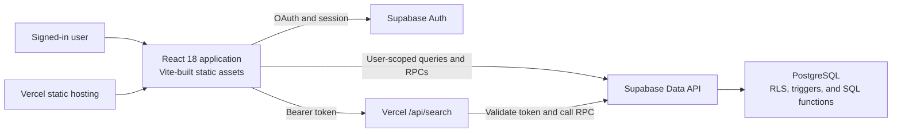

# Momentum architecture

This guide describes the application as it is implemented: where its
responsibilities live, how data moves through the system, and how to develop,
configure, and deploy it. The React source and timestamped SQL migrations are
the implementation references; update this guide when those boundaries change.

## 1. System at a glance

Momentum is a browser-based React single-page application. Supabase provides
identity and PostgreSQL access. Vercel serves the built application and runs
the authenticated username-search endpoint.



The browser never connects directly to PostgreSQL. Supabase's Data API is the
database boundary: row-level security (RLS) protects owner data, and
purpose-built SQL functions provide the cross-user operations used by search
and public profiles. The browser uses only the Supabase publishable key. The
search function validates the caller's access token and forwards that same
user context to Supabase; it does not use a service-role key.

| Component | Responsibility |
| --- | --- |
| React app | Screens, interaction state, client-side validation, and feature-level data requests |
| Supabase Auth | Google OAuth, session restoration, and authenticated identity |
| Supabase Data API | Authenticated database queries and RPC calls |
| PostgreSQL | Account-owned records, RLS, triggers, and curated profile operations |
| Vercel | Static app delivery, SPA rewrites, and `api/search.js` |
| Browser storage | Theme, view preferences, selected track, and account-scoped caches |

## 2. Application composition

### Startup and authentication

`src/main.jsx` mounts the app under React Strict Mode and an error boundary,
loads the global style layers, and starts route-based preloading.
`src/App.jsx` lazy-loads the sign-in, onboarding, and authenticated
experiences. `useAuthentication` owns session restoration, Google sign-in,
profile lookup, sign-out, and the top-level app state:

```text
LOADING -> UNAUTHENTICATED
        -> ONBOARDING
        -> AUTHENTICATED
```

A cached account and its cached data can render while Supabase validates the
session and refreshes server data. Progress loads in parallel with built-in
sheet setup. Transient session or profile lookup failures preserve the signed-in
state and expose retry instead of sending users to sign-in. A confirmed missing
session or explicit sign-out clears Momentum-owned local storage; switching
accounts also clears it.

### Authenticated screen selection

`AuthenticatedApp` composes feature hooks and builds the context passed to
`AuthenticatedScreens`. The application uses the browser History API and a
`popstate` listener rather than a routing library.

| Path | Screen | Access |
| --- | --- | --- |
| `/` | Sign-in, onboarding, or Tracker, depending on auth state | Tracker requires sign-in |
| `/profile` | Owner profile and progress | Sign-in required |
| `/profile/edit` | Name and username settings | Sign-in required |
| `/daily-log` | Daily Log, Full Log, and Trends | Sign-in required |
| `/people` | Username search | Sign-in required |
| `/user/:username`, `/u/:username` | Curated public profile | Sign-in required |
| `/api/search?q=<prefix>` | Username-search function | Valid bearer token required |

The Vercel rewrite serves `index.html` for client-side paths; `/api/search` is
provided by the serverless function.

### Feature ownership

```text
src/
  App.jsx                         Auth state -> auth or signed-in app
  main.jsx                        React root, error boundary, global styles
  features/
    auth/                         Sign-in, onboarding, session lifecycle
    dashboard/                    Signed-in app composition and navigation
    sheets/                       Built-in copies, upload parser, sheet selection
    problem-tracker/              Problem tree, filters, progress persistence
    daily-log/                    Day editor, Full Log, Trends, history, timers
    activity/                     Activity heatmap and sleep/study charts
    profile/                      Owner profile, metrics, progress backup
    people/                       Search and public profile loading
    testing/                      Test-mode-only sample-data tools
  shared/
    components/                   Header, dialogs, loading, menus, reusable UI
    lib/                           Supabase client, preload helpers, browser cache
    utils/                         Shared date and time logic
  styles/                          Global tokens, layout, theme, responsiveness
api/search.js                      Authenticated Vercel search function
source/                            Editable text for built-in tracks
supabase/migrations/               Database schema, policies, and functions
```

Feature-specific behavior stays with its feature. Shared code belongs in
`src/shared/` only when it is used across features. Component styles are kept
near components where practical; global CSS import order in `src/main.jsx`
matters to the cascade.

## 3. Feature and data flows

### Learning tracks and problem progress

Built-in track sources are plain text files in `source/`. The
`convert-sheet` script parses one source into JSON under
`src/features/sheets/data/`. At runtime, `bootstrapBuiltInSheets` submits
versioned built-in templates to `ensure_builtin_sheet_copies`, which creates
per-user copies without overwriting existing copies. Follow-up bootstrap RPCs
synchronize supported titles and LeetCode IDs on existing copies by stable
problem ID. These metadata updates preserve problem progress and other saved
sheet data. New accounts receive the current bundled template. The selected
track is stored in browser storage.

Users may upload `.txt` tracks up to 2 MB. `parseSheet` validates and
normalizes steps, subsections, problem names, and external problem numbers
before storing the sheet in `user_sheets`. Problems start as `todo`; users
mark them done or skipped in the tracker. The frontend namespaces problem IDs
by track so identical source IDs from different tracks do not collide. Sheet
deletion uses the ownership-checking
`delete_user_sheet` RPC and removes related progress safely.

Problem states are `todo`, `done`, and `skipped`. A missing progress row means
`todo`. `useProgress` loads account-owned rows, applies state changes
optimistically, and serializes database writes. It also maintains a per-user
browser cache; this is a performance layer, not a durable offline write queue.

The `progress` table is the source for solved states and completion dates.
A PostgreSQL trigger updates `activity_log` in the same transaction when
progress rows are inserted, changed, or deleted. Owner profile streaks and
heatmap data are derived from solved-progress activity.

### Daily Log, Full Log, and Trends

`useDailyLog` composes editing, persistence, history, timer, and activity-color
hooks. A daily record is keyed by user and local calendar date. It stores
sleep/wake times and `custom_tasks`, where each activity has its timed slots.

```text
Edit a day
  -> validate time intervals
  -> update view state and account/date cache
  -> debounce autosave
  -> serialize pending writes
  -> compare remote updated_at
  -> upsert only if the saved version still matches
```

Autosave is delayed until edits settle. Before an upsert, persistence compares
the row's current `updated_at` to the version originally loaded. If another
session has changed the day, the app reports a conflict rather than silently
overwriting it. Pending edits are flushed before changing dates or clearing
history. Running timers are stored per account and split at local midnight.

Full Log history loads on demand in pages of ten records, using an extra row
to detect older history. A short-lived account-scoped cache avoids repeating
recent reads. Trends loads a bounded recent window. Full Log derives untracked
time from the portion of a 24-hour day not covered by activity or sleep; that
value is calculated for display and is not stored separately. Sleep intervals
that span midnight are assigned to the date on which the user wakes.

Activity colors are assigned per account and normalized activity name in
`activity_color_assignments`. SQL functions allocate and update colors;
database triggers assign colors for saved activity and remove assignments
when no saved log uses them. Daily Log, Full Log, and Trends use the same
mapping.

### Profiles and people

The owner profile combines identity, per-track completion summaries, streaks,
recent accepted problems, and activity visualizations. Profile metrics are
derived in `useProfileMetrics`; progress export/import is handled by
`useProgressBackup`.

People search calls `GET /api/search?q=<prefix>`. The function accepts a
3–48 character alphanumeric/hyphen prefix, requires a valid bearer token,
calls `search_public_profiles` with the caller's token, and returns at most
five `{ username, name }` matches. Responses use `private, no-store` caching.

Public profiles are visible to signed-in Momentum users, not anonymous
visitors. The app retrieves profile summaries and activity through
purpose-built RPCs instead of allowing broad reads from `profiles`,
`progress`, or `daily_logs`. **The current public profile includes the
account email address** through `get_public_profile_email`; it is not private
from other signed-in users. The profile RPCs also expose selected progress,
sheet summaries, recent accepted items, and activity aggregates, but not raw
uploaded sheet JSON or detailed Daily Log records.

Progress exports contain saved `done` and `skipped` states for a selected
track. Imports validate the file and match problems by namespaced ID, local
ID/title, or an unambiguous normalized title; unmatched and ambiguous records
are not applied.

## 4. Data ownership and persistence

Timestamped files in `supabase/migrations/` define schema changes, indexes,
policies, triggers, and RPCs. The migrations are authoritative for exact SQL
signatures.

| Table | Contents and ownership |
| --- | --- |
| `profiles` | Account identity and onboarding state; keyed to `auth.users` |
| `user_sheets` | Built-in personal copies and user-uploaded track JSON |
| `user_deleted_builtin_sheets` | Tombstones that keep deleted built-in copies from being recreated |
| `progress` | Per-user problem state and completion timestamps |
| `activity_log` | Per-user activity counts by date, maintained from solved progress |
| `daily_logs` | Per-user date, sleep/wake times, and activity/task slots |
| `activity_color_assignments` | Per-user normalized activity name and selected color |
| `user_settings` | Legacy account settings table; active UI preferences are browser-local |

Account-owned records use user IDs and cascading foreign keys. Indexes support
owner/date history, progress lookup, built-in copy uniqueness, and username
search. Data may also be cached in browser storage using account-scoped
Momentum keys. Caches are cleared on sign-out and account switches; they do
not synchronize between devices and do not guarantee writes while offline.

## 5. Security and privacy boundaries

- RLS protects account-owned records using the authenticated user identity.
- The frontend contains only `VITE_SUPABASE_URL` and the publishable key.
  Never place a service-role key or other secret in browser code or a
  `VITE_` variable.
- Cross-user operations use SQL functions with explicit return shapes and
  grants. Keep the public profile and search functions narrowly scoped.
- Public profiles are authenticated-only, but currently expose the account
  email address as described above. Treat email as visible to other signed-in
  users unless the RPC and UI are changed.
- The search endpoint validates the bearer token and invokes its RPC with that
  token; it does not bypass RLS with a privileged key.
- Detailed daily activity records and raw uploaded track contents are not
  included in the public profile response.
- Local test-data tools require Vite development mode, the `test` mode, and
  `VITE_ENABLE_SAMPLE_DATA_TOOLS=true`. They verify the signed-in user and
  write through RLS. Use a dedicated test account.

Important RPCs include `is_username_available`,
`search_public_profiles`, `get_public_profile`,
`get_public_profile_email`, `get_public_activity`,
`ensure_builtin_sheet_copies`, `delete_user_sheet`,
`sync_builtin_sheet_problem_titles`, `sync_builtin_sheet_problem_links`,
`get_or_assign_activity_color`, and `set_activity_color`.

## Local development and deployment

### Prerequisites and environment

Use Node.js 20 (the version used by CI), npm, and a Supabase project.
Configure the frontend and Vercel function with:

```dotenv
VITE_SUPABASE_URL=https://your-project.supabase.co
VITE_SUPABASE_PUBLISHABLE_KEY=sb_publishable_your-key
```

These are public client settings, not secrets. Copy `.env.example` to `.env`,
fill in the project values, and run:

```powershell
npm ci
npm run dev
```

Vite serves on port `5173` by default. To exercise the Vercel function locally,
use `npx vercel dev` instead of Vite alone.

### Supabase setup

For a new project:

1. Apply every SQL migration in `supabase/migrations/` in filename order.
2. Enable Google in Supabase Auth and configure the Google OAuth callback URL
   shown by Supabase in the Google provider settings.
3. Set the Supabase Auth Site URL to the intended app origin and add local,
   production, and intended Vercel Preview origins to the allowed redirect
   URLs.
4. Configure `VITE_SUPABASE_URL` and `VITE_SUPABASE_PUBLISHABLE_KEY` for the
   local app and the Vercel project.

For an existing database, apply only migrations that have not already been
applied. Migrations are append-only schema history; do not edit or replay a
migration on a shared database. Reuse an existing Supabase project when its
accounts and data must be retained.

### Build, tests, and CI

```powershell
npm test
npm run lint
npm run build
npm run preview
```

Vitest runs the unit and component tests in jsdom. ESLint checks JavaScript
and JSX. GitHub Actions runs lint, tests, and a production build on pushes
and pull requests. There is no end-to-end browser-test command configured.

### Deploy to Vercel

Vercel builds with `npm run build` and serves `dist/`. `vercel.json` rewrites
client-side routes to `index.html` and gives versioned assets immutable cache
headers. The `/api/search` function also needs the two Supabase environment
variables above. After changing environment values, redeploy so the built
assets and function receive them.

The current deployment is [momentum-rehnx.vercel.app](https://momentum-rehnx.vercel.app/).

### Built-in track maintenance

1. Edit a source in `source/`, such as `source/dsa.txt`.
2. Convert it, for example: `npm run convert-sheet -- dsa`.
3. Review the generated JSON in `src/features/sheets/data/` and run the
   relevant tests and build.
4. If the change adds or updates metadata on existing built-in copies, include
   the corresponding bootstrap RPC and timestamped SQL migration. Apply all
   unapplied migrations before deploying the matching frontend.

Existing users keep their built-in copies and progress. Bootstrap synchronizes
supported titles and LeetCode IDs by stable problem ID while preserving
progress and other saved sheet data. The sync applies on the next successful
authenticated bootstrap.

### Local sample-data workflow

Sample-data controls are enabled only when all of the following are true:

- The app is running in Vite development mode.
- The Vite mode is `test` (`npm run dev:test`).
- `.env.test.local` sets `VITE_ENABLE_SAMPLE_DATA_TOOLS=true`.

`.env.test.local` inherits the Supabase URL and publishable key from `.env`.
Use a dedicated second account and verify its email before seeding. The tools
write and remove `daily_logs`, `progress`, and `activity_log` rows for the
currently signed-in account; they leave profile and sheet records in place.
They do not use a service-role key or a separate database.

## 7. Troubleshooting

| Symptom | Check |
| --- | --- |
| Supabase is not configured | Set both Vite variables in `.env` and restart the dev server. |
| Google sign-in fails | Check the Supabase provider, Google callback URL, Site URL, and allowed redirects. |
| Profile or sheet setup fails | Confirm all required migrations were applied and inspect the Supabase error. |
| Progress does not sync | Check the visible sync error, network request, and RLS policies. Optimistic changes are not an offline queue. |
| Daily Log cannot load or save | Check the daily-log migrations, owner policy, date, and database error. |
| Username search fails | Use `npx vercel dev` locally and check function environment, bearer token, prefix, and RPC grants. |
| A deep link fails after refresh | Confirm Vercel's SPA rewrite and `/api/search` function are deployed. |
| An existing user sees a stale built-in title or LeetCode link | Deploy the matching frontend and apply its metadata-sync migrations; the next successful authenticated bootstrap updates matching problem IDs without changing progress. |

## 8. Maintenance rules

- Keep feature behavior with its owning feature; share only genuinely common
  code through `src/shared/`.
- Preserve account boundaries in both client queries and database policies.
- Keep public RPC return values and grants reviewed against the current
  profile disclosure policy, especially the public email field.
- Treat caches as a performance layer, not as offline synchronization.
- Add timestamped migrations for database changes; never mutate an already
  applied migration.
- Preserve browser-storage key compatibility unless a migration is planned.
- Preserve global stylesheet import order when changing the cascade.
