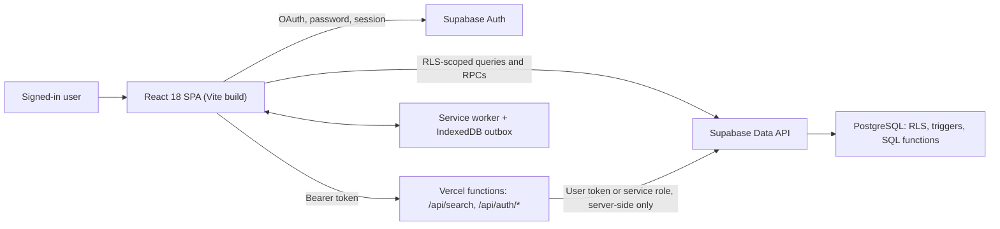

# Momentum architecture

Momentum is a browser-based React single-page application for learning tracks, daily time tracking, and progress insights. Supabase provides identity and PostgreSQL. Vercel serves the static build and runs two small serverless functions. The React source and the timestamped SQL migrations are the implementation references; this guide explains how they fit together.

## 1. System overview



| Component | Responsibility |
| --- | --- |
| React app | Screens, interaction state, client validation, feature data access |
| Supabase Auth | Google OAuth, email/password, session restore |
| Supabase Data API | Authenticated queries and RPC calls (the only database boundary) |
| PostgreSQL | Owned records, RLS, triggers, curated cross-user SQL functions |
| Vercel static hosting | Built assets, SPA rewrites, cache headers |
| Vercel functions | User search and username sign-in |
| Browser storage | Theme, view preferences, account-scoped caches, offline mutation outbox |
| Service worker | App-shell precache, offline navigation, push and sync hooks |

The browser never connects to PostgreSQL directly and only holds the Supabase URL and publishable key. The service-role key exists only in Vercel's server environment and is used by username sign-in.

## 2. Technology

| Layer | Choice |
| --- | --- |
| UI | React 18, JavaScript (ES modules), Tailwind CSS 3 plus component-scoped CSS, Lucide icons |
| Build | Vite 5 (emits `manifest.json` for service-worker precaching) |
| Backend | Supabase (Auth, PostgREST, PostgreSQL) |
| Hosting | Vercel (static output in `dist/`, serverless functions in `api/`) |
| Quality | Vitest, Testing Library, react-test-renderer, ESLint, Prettier (with SQL plugin), GitHub Actions |
| Runtime | Node.js 22 or newer |

## 3. Repository layout

```text
api/                 Vercel functions: search, auth/username-login
docs/                Architecture, screenshots
public/              Manifest, service worker, icons, assetlinks
scripts/             Track conversion and LeetCode link tooling
source/              Editable text sources for built-in tracks
src/
  features/
    activity/        Heatmap, sleep/activity chart, summaries
    auth/            Sign-in, onboarding, session lifecycle
    daily-log/       Day editor, Full Log, Trends, timers, persistence
    dashboard/       Signed-in composition, navigation, tracker screen
    people/          Username search and public profiles
    problem-tracker/ Problem tree, filters, progress persistence
    profile/         Owner profile, metrics, backup, settings
    sheets/          Built-in and uploaded tracks
    testing/         Test-mode sample-data tools
  pwa/               Launch, share, file, sync, push integration
  shared/            Reusable UI, Supabase client, caches, offline sync, utilities
  styles/            Tokens, layout, themes, responsive layers
supabase/migrations/ Ordered schema, policy, and function history
```

Feature behavior lives in `src/features/<feature>/`. Code moves to `src/shared/` only when more than one feature uses it. Global CSS import order in `src/main.jsx` is part of the cascade and must be preserved.

## 4. Application composition

### 4.1 Startup and authentication

`main.jsx` mounts the app under `React.StrictMode` and an error boundary, loads the global style layers, registers the production service worker, and starts route-based preloading. `App.jsx` lazy-loads sign-in, onboarding, and the authenticated experience.

`useAuthentication` owns session restore, Google sign-in, email/password sign-in, username sign-in, sign-up, profile lookup, and sign-out:

```text
LOADING -> UNAUTHENTICATED
        -> ONBOARDING
        -> AUTHENTICATED
```

- A cached account (`momentum:account-cache`) lets the shell render while Supabase validates the session and refreshes the profile.
- Transient session or profile failures keep the signed-in state and offer retry.
- A confirmed missing session or explicit sign-out clears Momentum-owned caches and the account cache.
- Account switches clear caches too. The offline outbox and built-in sync markers are kept, because outbox entries are user-scoped and must still sync.
- Email sign-up uses Supabase Auth directly and follows the project's email-confirmation setting. Username sign-in (`/api/auth/username-login`) resolves username to email server-side and returns a session only after password authentication succeeds.

### 4.2 Routing

The app uses the History API and a `popstate` listener instead of a router library (`useAuthenticatedNavigation`). Vercel rewrites client paths to `index.html`.

| Path | Screen |
| --- | --- |
| `/` | Tracker |
| `/daily-log` | Daily Log, Full Log, Trends |
| `/people` | Username search |
| `/user/:username`, `/u/:username` | Public profile |
| `/profile` | Owner profile |
| `/profile/edit` | Name and username settings |
| `/api/search?q=` | Username search function |
| `/api/auth/username-login` | Username sign-in |

All app screens require sign-in. `AuthenticatedApp` composes the feature hooks and passes one context object to `AuthenticatedScreens`, which selects the screen. Heavy hooks take an `enabled` flag so inactive screens do no work.

## 5. Features and data flows

### 5.1 Learning tracks and progress

- **Sources.** Built-in tracks are plain text in `source/`. `convert-sheets` parses every source into JSON under `src/features/sheets/data/`, preserving IDs by LeetCode number or unlinked title when rows move. For DSA, `create-links` generates LeetCode links and difficulty maps and `verify-links` audits them against LeetCode.
- **Per-user copies.** On first load per manifest version, `bootstrapBuiltInSheets` calls `ensure_builtin_sheet_copies` and `sync_builtin_sheet_data`. Copies are stored in `user_sheets` with a `builtin_template_id`. The sync updates the full track using stable problem IDs and never touches progress. A completion marker per user avoids repeating the work.
- **Deletion.** Deleting a built-in copy records a tombstone in `user_deleted_builtin_sheets` so it is not recreated. `delete_user_sheet` removes the sheet and its progress. `restore_builtin_dsa_sheet` reinstates the DSA copy and resets its progress.
- **Uploads.** Users can upload `.txt` tracks up to 2 MB. `parseSheet` validates and normalizes steps, subsections, titles, and `(LC n)` numbers before the sheet is saved to `user_sheets`.
- **Progress.** States are `todo`, `done`, and `skipped`; a missing row means `todo`. Progress IDs are namespaced by sheet (`custom-<uuid>::<problemId>`).
  - `useProgress` applies changes optimistically, writes the cache and the offline outbox, then syncs.
  - Writes are serialized through a queue.
  - Completion dates (`completed_on`, `updated_at`) are stored per solved problem.
- **Activity counts.** A database trigger maintains `activity_log` in the same transaction as progress changes. Streaks and heatmaps derive from solved progress.
- **Backup.** Export writes `done` and `skipped` states per sheet. Import matches by namespaced ID, local ID plus title, or an unambiguous normalized title; unmatched and ambiguous records are ignored.

### 5.2 Daily Log, Full Log, Trends

`useDailyLog` composes persistence, history, timer, activity, and color hooks. A day is keyed by `(user_id, date)` in `daily_logs` and stores `sleep_time`, `wake_time`, and `custom_tasks` (activities with timed slots). Built-in sheets appear as activities with ID `sheet:<id>` and display the current sheet title.

```text
Edit -> validate intervals -> update state and per-day cache
     -> debounce autosave (300 ms) -> queue outbox mutation
     -> compare remote updated_at -> upsert only if version matches
```

- **Validation** blocks malformed or inverted slots, incomplete sleep, and days over 24 hours. Overlaps are warnings shown beside the affected slots.
- **Conflicts.** If the cloud copy changed since it was loaded, the local edit is preserved and the user chooses "Use cloud copy" or "Replace cloud with my copy".
- **Save status** is separate from validation. A visible Save now / Retry save action is offered when a save is pending or failed. Pending saves flush before date changes, view changes, and when the page is hidden.
- **Timers** are stored per account, survive reloads, and split at local midnight. Each segment carries a stable `timerId` so replays never duplicate time.
- **Full Log** loads history in pages of ten (one extra row detects older history). Each day shows a share-of-time bar for activities, sleep, and untracked time; untracked time is derived from the uncovered part of 24 hours and is never stored. Sleep that crosses midnight is attributed to the wake date.
- **Trends** loads a bounded recent window and shows charts (7 or 30 days depending on width), averages, and weekly totals of where time went.
- **Colors.** `activity_color_assignments` maps a normalized activity name to a palette color or custom hex per user. SQL functions allocate colors, triggers assign them on save and remove unused ones, and Day, Full Log, and Trends share one mapping. Sleep has a fixed color.

### 5.3 Profiles and people

- The owner profile combines identity, per-sheet completion, streaks, recent accepted problems, a yearly heatmap, and backup controls (`useProfileMetrics`, `useProgressBackup`).
- Search calls `GET /api/search?q=<prefix>`. The function checks the prefix (3 to 48 letters, digits, hyphens), requires a bearer token, validates it, calls `search_public_profiles` in that user's context, and returns at most five `{ username, name }` results with `private, no-store` caching.
- Public profiles are visible to signed-in users only. They use purpose-built RPCs (`get_public_profile`, `get_public_activity`) rather than broad table reads. They expose names, usernames, solved and skipped counts, sheet summaries, recent accepted items, streaks, and activity aggregates. Email addresses, raw uploaded sheet JSON, and detailed Daily Log records are not exposed.
- The client caches public profiles for 60 seconds (20 entries) and refreshes the heatmap every 15 seconds while visible.

### 5.4 Usernames

Usernames are 3 to 20 characters: lowercase letters, numbers, and hyphens. Uniqueness is case-insensitive (`profiles_username_lower_unique`). `is_username_available` supports live checks, and a trigger rejects over-length usernames. New accounts get a generated username (7-character prefix, hyphen, 12 ID characters) until onboarding replaces it.

## 6. Offline and PWA

- **Outbox.** Offline-capable writes go through `offlineMutationStore` (IndexedDB, with `localStorage` fallback) and are replayed by `offlineSync`. Entries are keyed `userId:type:entityId` and replayed idempotently. Types: `progress`, `daily-log`, `daily-log-slot`, `activity-color`, `delete-daily-logs`.
- **Sync triggers.** Sync runs on reconnect, when the tab becomes visible, after local writes, and from the header's "Sync now" action. `OfflineSyncStatus` shows connection state and pending counts. Daily-log syncs return conflicts instead of overwriting.
- **Service worker.** `sw.js` precaches the app shell and the Tracker and Daily Log chunks from `manifest.json`. Navigation is network-first with a cached-shell fallback, and `/assets/` is cache-first. Same-origin only; `/api/` and Supabase requests are never cached. Offline use requires a prior online sign-in on the same device.
- **Install surface.** The manifest declares shortcuts, a share target, a `.txt` file handler, and a `web+momentum` protocol handler; `pwaIntegration` consumes them. Push and background-sync handlers exist in the worker and the client helper, but push needs a sender you provide. `.well-known/assetlinks.json` supports the Android wrapper.
- **Not guaranteed.** Edits made offline are not guaranteed to survive if the browser clears storage. Sign-in, search, sheet management, and public profiles need a connection.

## 7. Data model

Migrations in `supabase/migrations/` are authoritative for exact SQL.

| Table | Contents |
| --- | --- |
| `profiles` | Identity, username, onboarding state (keyed to `auth.users`) |
| `user_sheets` | Per-user built-in copies and uploaded tracks (JSON) |
| `user_deleted_builtin_sheets` | Tombstones for deleted built-in copies |
| `progress` | Per-problem state and completion dates |
| `activity_log` | Per-date solved counts, trigger-maintained |
| `daily_logs` | Per-date sleep, wake, activity slots, `updated_at` |
| `activity_color_assignments` | Per-user activity-name to color |
| `user_settings` | Legacy; UI preferences are browser-local |

Key functions: `is_username_available`, `search_public_profiles`, `get_public_profile`, `get_public_activity`, `ensure_builtin_sheet_copies`, `restore_builtin_dsa_sheet`, `delete_user_sheet`, `sync_builtin_sheet_data`, `get_or_assign_activity_color`, `set_activity_color`.

Key triggers: signup profile creation, progress to `activity_log` sync, daily-log color assign and cleanup, username length enforcement.

Account-owned rows use user IDs with cascading foreign keys. Indexes cover owner and date history, progress lookup, built-in copy uniqueness, and username prefix search.

## 8. Security and privacy

- RLS protects every owned table using the authenticated user's ID.
- Cross-user reads happen only through SQL functions with explicit return shapes, `SECURITY DEFINER`, a fixed `search_path`, and grants restricted to `authenticated`.
- The frontend contains only `VITE_SUPABASE_URL` and the publishable key. The service-role key is server-only and never uses a `VITE_` prefix.
- `/api/search` forwards the caller's token and never uses a privileged key.
- Auth endpoints return generic credential errors and are `no-store`.
- Public profiles do not expose account email addresses.
- Test-data tools require Vite dev mode, `test` mode, and `VITE_ENABLE_SAMPLE_DATA_TOOLS=true`. They verify the signed-in user and write through RLS, so use a dedicated test account.

## 9. Local development and deployment

**Setup**

```powershell
Copy-Item .env.example .env
npm ci
npm run dev        # Vite on :5173
```

```dotenv
VITE_SUPABASE_URL=https://your-project.supabase.co
VITE_SUPABASE_PUBLISHABLE_KEY=sb_publishable_your-key
SUPABASE_SERVICE_ROLE_KEY=      # server-only, never VITE_-prefixed
```

**Supabase**

1. Apply every migration in filename order. Never edit an applied migration; add a new timestamped one.
2. Enable Google and Email providers; set the Site URL and allowed redirect URLs (local, production, preview).
3. Enable email confirmations, configure production email delivery, and review Supabase Auth rate limits before opening public sign-up.
4. Use `npx vercel dev` instead of `npm run dev` to exercise the API functions locally.

**Commands**

| Command | Purpose |
| --- | --- |
| `npm run dev` / `dev:test` | Dev server / test-mode server on :5174 |
| `npm run build` / `preview` | Production bundle / serve it |
| `npm test` / `npm run lint` / `npm run format` | Vitest / ESLint / Prettier |
| `npm run convert-sheet -- <name>` | Build a track's JSON from `source/` |
| `npm run convert-sheets` | Build JSON for every text source |
| `npm run create-links` / `verify-links` | Generate / audit DSA LeetCode data |

**CI.** GitHub Actions runs lint, tests, and build on every push and pull request. There is no end-to-end browser suite.

**Deploy.** Vercel runs `npm run build` and serves `dist/`. `vercel.json` rewrites client routes, makes hashed assets immutable, and sets no-cache on the shell, `sw.js`, and the manifest. Set the two public variables for all functions and `SUPABASE_SERVICE_ROLE_KEY` as a server-only variable, then redeploy after changing environment values.

**Built-in track changes.** Edit `source/`, run `npm run convert-sheets`, and commit the generated JSON. The converter matches existing items by LeetCode ID or title so row reordering preserves problem IDs and progress. Existing users receive the updated full track on their next sign-in. After DSA changes, run `npm run create-links` to refresh links and difficulty metadata. Apply the `sync_builtin_sheet_data` migration before deploying the frontend.

## 10. Testing and troubleshooting

Vitest runs unit and component tests in jsdom (single worker). Coverage centers on time and interval logic, persistence and conflict handling, offline sync, caches, authentication, the problem tree, charts, and key components.

| Symptom | Check |
| --- | --- |
| "Supabase is not configured" | Both Vite variables set; restart dev server |
| Google sign-in fails | Provider, callback URL, Site URL, redirect list |
| Username sign-in fails | `SUPABASE_SERVICE_ROLE_KEY`; use `vercel dev` locally |
| Profile or sheet setup fails | All migrations applied; inspect the Supabase error |
| Progress or Daily Log not syncing | Sync status icon, retry, network tab, RLS policies |
| Username search fails | `vercel dev`, bearer token, prefix length, RPC grants |
| Deep link 404 after refresh | Vercel rewrite and function deployed |
| Stale track title or LeetCode link | Deploy matching frontend and migrations, then sign in again |
| Stale app after deploy | Service worker updates on next load; a one-time chunk reload is automatic |

## 11. Maintenance rules

- Keep feature behavior in its feature; share only genuinely common code.
- Preserve account boundaries in client queries and database policies alike.
- Review public RPC return shapes and grants against the disclosure policy in section 8.
- Keep caches (disposable) separate from the outbox (durable, user-scoped, replay-safe).
- Preserve browser-storage key names unless a migration path exists.
- Preserve global stylesheet import order.